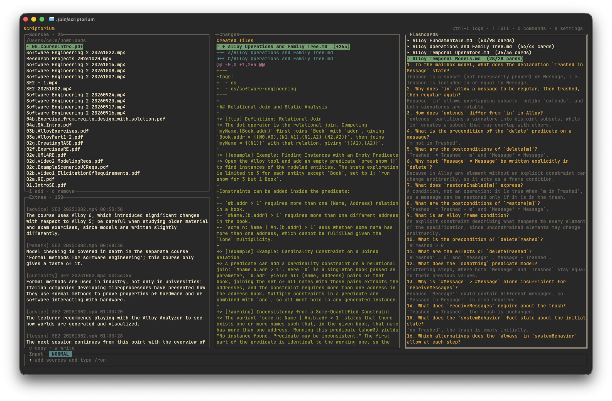

# Scriptorium

> [!WARNING]
> This repository is still unstable, though your notes are safe. Take precautions and please report bugs.



The operating system for students who care about details and their own time.

Scriptorium, although highly customizable, is written with a few pillars in mind:
- **Obsidian Vault**: by default, the generated notes use outgoing links to connect notes to one another.
- **Spaced Repetition**: by default, drafted flashcards [1] are generated at the end of each note using a custom syntax for [this Obsidian plugin](https://github.com/st3v3nmw/obsidian-spaced-repetition). 
- **Recorded Lessons**: Scriptorium is at its best when loading recordings or audio files.
- **Extensibility**: Scriptorium exposes its own API for creating custom panes. See [Extending the interface](#extending-the-interface).
- **Review**: generated content is raw! Scriptorium helps by providing the best possible starting point, but you will have to add, remove and reorganize information.

The codebase is organized so that you can customize most of these behaviors (surely not the last one!) with your trusted agent.

\[1\]: To avoid having gazillions of flashcards, by default flashcards are drafted, i.e., commented. You can decide which flashcards to activate either via an automation or manually.

The pipeline is roughly as follows:

```text
video.mp4 -> audio.mp3 -> transcript -> knowledge units -> vault plan -> notes -> flashcards
```


The next sections will describe in more detail and more formally (i.e., they are AI-generated) how Scriptorium works and all its features.


## Pipeline stages

1. **sources**: every document is converted to text (PDF, DOCX, plain text, etc.)
2. **prepare**: resolve the course MOC and, when configured, the spoken language.
3. **audio**: `ffmpeg` to mono 16 kHz MP3 per media source, duration verified.
4. **transcribe**: a local transformers speech-to-text model, an OpenAI-compatible `/audio/transcriptions` endpoint, or a Hugging Face router/Inference Endpoint per media source.
5. **extract**: each source is chunked and every chunk becomes typed knowledge units (definitions, examples, formulas, exercises, remarks), keeping provenance (file, timestamp or page/slide) on every unit. Off-topic details (exams, university logistics, links, curiosities) become `asides` instead: they are shown in the TUI Extras pane and are not written into notes.
6. **group**: the model splits the sources into ordered topic groups, each group being the material that covers one macro-topic. Every source appears in exactly one group.
7. **outline → compose → apply → flashcards**: run once per group, in the proposed order.  Because a group is applied before the next one is planned, later groups see the notes the earlier groups created: a slides-first run merges cleanly into a lecture that arrives later.
8. **cleanup**: audio, SRT and per-group intermediates removed by default.
9. **report**: `report.md` with groups, files touched, card counts, token usage, warnings, and TODOs.

## Features

- **MOC-driven organization.** A MOC (Map of Content) is the entry point of a course. Scriptorium matches sources against existing MOCs, prompts you before creating or using one and updates the MOC table of contents. The model proposes a note title, but the vault decides where the material belongs: existing notes are ranked by title and heading match, then the note is created, appended, or merged accordingly.
- **Any source, mixed freely.** Lectures, slides, PDFs, notes and spreadsheets can be combined in one run. A recording can be added later and merged into the notes created from the slides.
- **Local speech recognition, or a remote endpoint.** A local transformers speech-to-text model runs on the machine. An OpenAI-compatible `/audio/transcriptions` endpoint or a Hugging Face router/Inference Endpoint is one setting away.
- **The model never writes files.** It returns JSON validated by pydantic and applied by a deterministic applier.
- **Safe writes.** Appends are insert-only: the write is diff-checked and rolled back if any pre-existing line changed. Merges rewrite only the anchored section and are reviewed through their unified diff, or written as a conflict file outside the vault for manual reconciliation.
- **PDF figures.** Images are extracted, deduplicated, given a caption and nearby text when available, and embedded only when the note that references them is actually written.
- **Scanned pages.** Pages without a text layer are read by a vision model or locally with Tesseract.
- **Idempotent stages.** Each stage records its status and artifacts in the job directory, so completed work is not repeated.
- **Extensible panes.** Every box in the TUI is an independent module. See [Extending the interface](#extending-the-interface).

## Requirements

- GNU/Linux or macOS
- Python 3.11+
- `pydantic`
- `ffmpeg`
- For PDFs: poppler (`pdftotext`, `pdftohtml`, `pdftoppm`)
- For local scanned-page OCR: Tesseract
- For local speech recognition: `torch` and `transformers`

## Install

```bash
git clone https://www.github.com/alessiocelentano/scriptorium 
cd scriptorium
python3 -m pip install -e .
# add '.[asr]' for local speech recognition
```

On the first launch the TUI opens a short setup wizard (vault, model and speech). It writes the machine-local `config.toml` for you. Additional options are available in the in-app settings.

## Usage

### Interactive TUI

```bash
scriptorium
```

Collect one or more sources in the Sources pane, type `/run`, and review the proposed note changes and drafted flashcards in the other panes. Merge review and MOC selection happen in modals, so under the default `ask` policy a merge is not applied without review. `/history` lists every run, completed or failed. Select one and type `/resume` to continue it from the first unfinished stage. Type `/wizard` to reopen the setup wizard.

### Command line

```bash
# Full run: creates notes automatically and asks before merging into existing notes
scriptorium run ~/Downloads/lecture.mp4 --course "Linear Algebra"

# Several sources in one run, documents included
scriptorium run lecture.mp4 slides.pdf notes.md --course "Linear Algebra"

# Accept defaults: create notes and skip merges
scriptorium run lecture.mp4 --course "Linear Algebra" --yes

# Plan only, no vault writes
scriptorium run lecture.mp4 --course "Linear Algebra" --dry-run

# Continue the most recent unfinished job (for example after fixing an error)
scriptorium resume

# Continue a specific job (an unambiguous id prefix is enough)
scriptorium resume 20260101-120000-lecture

# Apply the plan saved by a dry run
scriptorium resume 20260101-120000-lecture --yes
```

Run `scriptorium run --help` or `scriptorium resume --help` for the full flag list.

## Extending the interface

Every box is a self-contained extension: one module exposing one `Pane` subclass that draws its own rectangle, owns its selection and scroll position, and handles its own keys. The panes live in `src/scriptorium/panes/` and it already contains some built-in ones. After creating a new pane, register it under `[tui_panes]` in `config.toml` and place it in `tui_layout`:

```toml
tui_layout = [
  "sources | changes | pomodoro",
  "input",
]

[tui_panes]
pomodoro = "my_panes.pomodoro:PomodoroPane"
```

The pane contract is documented in `docs/CUSTOM_PANES.md`; the public surface is `pane_api.py`.

## License

MIT. See [LICENSE](LICENSE).
